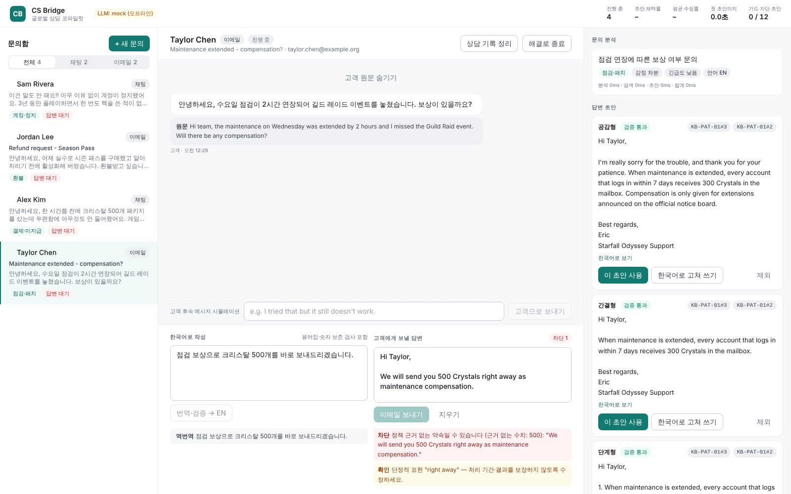

# CS Bridge — 글로벌 CS 상담원 코파일럿

해외 고객의 **채팅·이메일 문의**를 한국인 상담원이 빠르고 안전하게 처리하도록 돕는 LLM 애플리케이션입니다.
고객 메시지를 번역·분류하고, 사내 정책(RAG)을 근거로 답변 초안 3개를 만들고, **보내기 전에 규칙 기반 가드로 검증**합니다. 상담이 끝나면 상담 기록을 자동으로 정리합니다.

> 기획 배경: 게임사 글로벌 서버 북미 고객지원 5년 4개월 동안 영어 문의 응대·패치 공지 번역을 하며 겪은 문제
> (번역 시간, 정책에 없는 약속, 용어 불일치, 상담 기록 작성 부담)를 LLM으로 해결합니다.

| 라이트 | 다크 |
|---|---|
|  |  |

## 주요 기능

| 단계 | 하는 일 |
|---|---|
| 개인정보 마스킹 | 이메일·카드번호(Luhn 검증)·전화번호를 LLM에 보내기 전에 `[EMAIL]` 등으로 치환 |
| 분석 | 언어 감지, 한국어 번역, 의도 요약, 카테고리·감정·긴급도 분류, 검색용 쿼리 재작성 |
| 검색 (RAG) | 정책 문서를 섹션 단위로 검색(BM25 + CS 동의어 확장), 분류 결과를 가중치로 활용 |
| 답변 초안 | 공감형·간결형·단계형 3종, 채널별 형식(채팅/이메일), 근거 문서 ID 인용 |
| 한국어 → 고객 언어 | 상담원이 한국어로 쓰면 용어집을 지켜 번역하고 역번역을 함께 보여줌 |
| 검증 가드 | 아래 표 참고. `error`가 있으면 **보내기 버튼 비활성화 + 서버에서도 422로 차단** |
| 상담 기록 | 요약, 문의 내용, 조치, 후속 조치, 이관 여부, 태그 |
| KPI | 초안 채택률, 평균 수정률, 첫 초안까지 시간, 가드가 차단한 초안 수 |
| 다크 모드 | 라이트·다크·자동(OS 설정 추종), 새로고침 시 깜빡임 없음 |

### 검증 가드 (`backend/app/pipeline/validate.py`)

| 코드 | 수준 | 잡아내는 것 |
|---|---|---|
| `unsupported_promise` | 차단 | 환불·크리스탈·복구 약속인데 근거 문서에 없거나, 문서에 없는 수치(500개, 1시간 등) |
| `prohibited_promise` | 차단 | 정책상 상담원이 할 수 없는 약속 (예: 계정 정지 해제) |
| `conditional_policy` | 확인 | 조건이 있는 정책 (예: 시즌 패스는 활성화 후 환불 불가) |
| `number_mismatch` | 차단 | 한국어 원문의 숫자가 번역문에서 빠지거나 바뀜 |
| `pii` | 차단 | 답변에 개인정보 포함 |
| `ungrounded_citation` | 차단 | 검색되지 않은 문서를 근거로 인용 |
| `glossary` | 확인 | 용어집(이의 신청 → appeal 등) 미준수 |
| `absolute_wording` | 확인 | "right away", "guarantee" 등 단정적 표현 |
| `email_greeting/signoff`, `chat_length` | 확인 | 채널 형식 |

## 평가 (`backend/eval`)

```bash
cd backend && python -m eval.run_eval      # eval/report.md 생성
```

| 지표 | mock (오프라인 기준선) | Claude 연결 시 |
|---|---|---|
| 카테고리 정확도 (30건) | 0.80 | 측정 예정 |
| 검색 Hit@1 / Hit@3 (28건) | 0.71 / 0.93 | 측정 예정 (쿼리 재작성 효과) |
| 가드 정확도 (12건, 차단/확인/통과) | 1.00 | 동일 (규칙 기반) |
| 차단해야 할 답변 재현율 | 1.00 | 동일 |

mock 분류기는 키워드 규칙이라 의도적으로 기준선 역할을 합니다. `LLM_PROVIDER=anthropic`으로 같은 평가를 돌려 개선 폭을 비교합니다.

## 실행

```bash
# 1) 백엔드 (API 키 없이 mock 모드로 바로 실행)
cd backend
pip install -r requirements.txt
uvicorn app.main:app --reload --port 8000

# 2) 프론트엔드
cd frontend
npm install
npm run dev            # http://localhost:3000

# 실제 LLM 사용
export LLM_PROVIDER=anthropic ANTHROPIC_API_KEY=sk-ant-...
```

Docker: `cp .env.example .env && docker compose up --build`

테스트: `cd backend && pytest -q` (26개)

## 구조

```
backend/app
├── main.py              FastAPI 라우트
├── service.py           상담 워크플로 (고객 메시지 → 분석·검색·초안·검증 / 상담원 답변 / 요약 / KPI)
├── llm/                 Provider 인터페이스, Anthropic, 오프라인 mock
├── pipeline/
│   ├── pii.py           개인정보 마스킹
│   ├── retrieve.py      KB 파싱 + BM25 + 동의어 확장 (pgvector로 교체 가능한 인터페이스)
│   ├── steps.py         analyze / drafts / translate / summarize
│   ├── prompts.py       JSON 출력 프롬프트
│   ├── glossary.py      용어집
│   └── validate.py      검증 가드
├── kb/                  가상 게임 서비스 정책 문서 (영문 + 상담원용 한국어 요약)
└── data/glossary.json
frontend/                Next.js 상담원 콘솔 (문의함 · 대화 · 코파일럿 패널 · 작성기)
```

## 데이터

전 직장 자료는 사용하지 않았습니다. 가상 게임 **Starfall Odyssey**의 정책 문서·용어집·평가 문항을 직접 작성했습니다.

## 다음 단계

- [ ] Claude 연결 후 평가 수치 측정 및 프롬프트 개선
- [ ] 임베딩(BGE-M3) + pgvector 하이브리드 검색
- [ ] 상담원 수정 이력을 다음 초안에 반영하는 개인화
- [ ] 패치노트 다국어 번역기 (용어집 일관성 검사)
- [ ] 음성 상담(AICC): STT 연동
